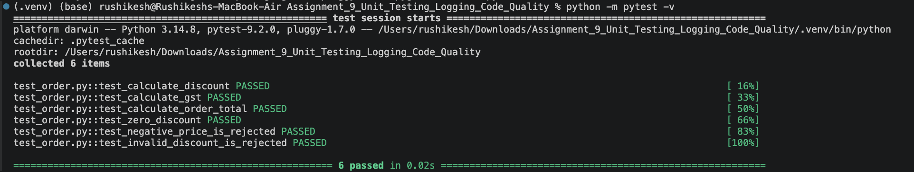
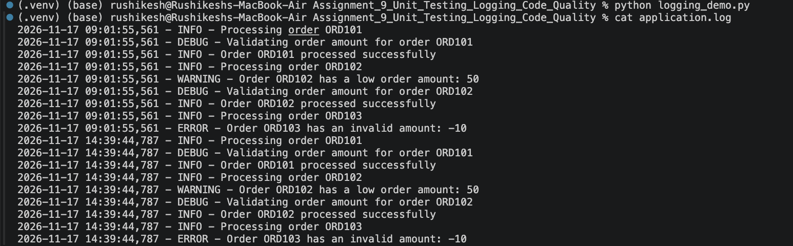
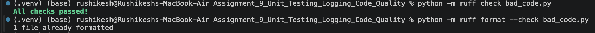
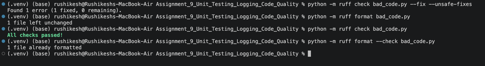

# Assignment 9 – Unit Testing, Logging and Code Quality

**Application:** Order Processing System  

---

## 1. Introduction

This assignment is based on Practical 10 – Unit Testing, Logging and Code Quality.

The main objective of this practical is to understand how unit testing, logging and code quality tools are used in Python programming.

In this assignment, I implemented an Order Processing System and used pytest for testing, Python's logging module for recording application activities, and Ruff for checking and formatting code.

## 2. Objectives

- Understand unit testing using pytest.
- Implement test cases for Python functions.
- Handle invalid inputs using exceptions.
- Understand different logging levels.
- Generate and inspect application log files.
- Identify code-quality issues using Ruff.
- Apply automatic fixes and format Python programs.

## 3. Project Structure

```text
Assignment_9_Unit_Testing_Logging_Code_Quality/
│
├── order.py
├── test_order.py
├── logging_demo.py
├── bad_code.py
├── application.log
├── README.md
├── .gitignore
│
└── Screenshots/
    ├── 01_Pytest_Results.png
    ├── 02_Logging_Output.png
    ├── 03_Ruff_Initial_Check.png
    ├── 04_Ruff_Final_Check.png
    └── 05_Ruff_Check_And_Format.png
```

## 4. Order Processing System – order.py

The `order.py` file contains three functions.

**1. calculate_discount()**

Calculates the discount amount based on the original price and discount percentage.

**2. calculate_gst()**

Calculates GST based on the given price and GST percentage.

**3. calculate_order_total()**

Calculates the final order amount after applying the discount and GST.

The program also handles invalid inputs using `ValueError`.

### Example Calculation

Consider an order with:

- Original price: ₹1,000
- Discount: 10%
- GST: 18%

Calculation:

1. Discount = ₹1,000 × 10% = ₹100
2. Discounted price = ₹1,000 − ₹100 = ₹900
3. GST = ₹900 × 18% = ₹162
4. Final order amount = ₹900 + ₹162 = **₹1,062**

Run the program:

```bash
python order.py
```

## 5. Unit Testing – test_order.py

The `test_order.py` file contains six test cases implemented using pytest.

The test cases check:

1. Correct discount calculation.
2. Correct GST calculation.
3. Correct final order total.
4. Zero discount.
5. Rejection of negative price.
6. Rejection of invalid discount.

### Execute the test cases

```bash
python -m pytest -v
```

**Expected result:** All six test cases should pass.

### Pytest Execution Screenshot



## 6. Logging Implementation – logging_demo.py

The `logging_demo.py` file demonstrates how Python logging is used to record application activities.

The program processes three sample orders:

| Order ID | Amount | Result |
|---|---:|---|
| ORD101 | ₹1,500 | Successfully processed |
| ORD102 | ₹50 | Low order amount warning |
| ORD103 | -₹10 | Invalid amount error |

### Logging Levels Used

| Level | Description |
|---|---|
| DEBUG | Detailed information useful for debugging. |
| INFO | Records normal application activities. |
| WARNING | Indicates an unexpected condition where the application can continue. |
| ERROR | Records an operation that has failed. |

### Execute the logging program

```bash
python logging_demo.py
```

View the generated log file:

```bash
cat application.log
```

The program generates `application.log` in the project directory.

### Logging Execution Screenshot



## 7. Code Quality Using Ruff – bad_code.py

Ruff is a Python tool used to identify common code-quality issues and maintain consistent formatting.

In this practical, I used Ruff to:

1. Check the original Python program.
2. Identify code-quality issues.
3. Apply automatic fixes.
4. Format the Python file.
5. Perform the final code-quality check.

### Commands Executed

**Step 1: Initial Ruff check**

```bash
python -m ruff check bad_code.py
```

**Step 2: Apply automatic fixes**

```bash
python -m ruff check bad_code.py --fix --unsafe-fixes
```

**Step 3: Format the Python file**

```bash
python -m ruff format bad_code.py
```

**Step 4: Perform the final Ruff check**

```bash
python -m ruff check bad_code.py
```

**Step 5: Verify formatting**

```bash
python -m ruff format --check bad_code.py
```

### Final Result

- Ruff identified an unused local variable.
- The automatic fix removed the unused variable.
- The Python file was formatted.
- The final Ruff check displayed `All checks passed!`.
- The formatting check confirmed that the file was already formatted.

### Initial Ruff Check



### Final Ruff Check


### Additional Ruff Output



## 8. Installation and Setup on macOS

Follow these steps to execute the project on macOS.

### Step 1: Check Python

```bash
python3 --version
python3 -m pip --version
```

### Step 2: Create a virtual environment

```bash
python3 -m venv .venv
```

### Step 3: Activate the environment

```bash
source .venv/bin/activate
```

### Step 4: Install required packages

```bash
python -m pip install --upgrade pip
python -m pip install pytest ruff
```

### Step 5: Verify installation

```bash
python -m pytest --version
python -m ruff --version
```

## 9. Complete Execution Commands

Run the following commands from the project directory.

```bash
# Run the order processing program
python order.py

# Execute unit tests
python -m pytest -v

# Run logging program
python logging_demo.py

# View application log
cat application.log

# Check code quality
python -m ruff check bad_code.py

# Apply automatic fixes
python -m ruff check bad_code.py --fix --unsafe-fixes

# Format the Python file
python -m ruff format bad_code.py

# Check code quality again
python -m ruff check bad_code.py

# Verify formatting
python -m ruff format --check bad_code.py
```

## 10. Learning Outcomes

After completing this assignment, I learned:

- How to write and test Python functions.
- How to use pytest for unit testing.
- How to validate inputs and handle exceptions.
- How to use DEBUG, INFO, WARNING and ERROR logging levels.
- How to generate and inspect application log files.
- How to identify code-quality issues using Ruff.
- How to apply automatic fixes and format Python code.

## 11. Conclusion

This assignment helped me understand the importance of unit testing, logging and code quality in Python programming.

Using pytest, I verified that the order-processing functions work correctly for valid and invalid inputs. Using Python logging, I recorded application activities and errors. Finally, Ruff helped me identify and correct code-quality issues and maintain consistent formatting.

Overall, this practical improved my understanding of writing, testing, debugging and maintaining Python programs.

---

**Assignment 9 – Unit Testing, Logging and Code Quality**  
**Practical 10 – Python Programming**